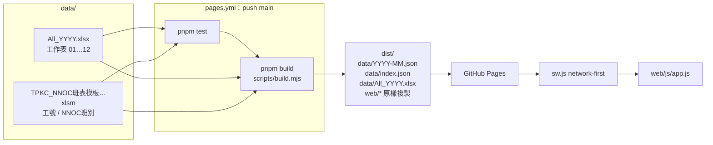

# 架構

純靜態站：建置時把 Excel 轉成 JSON，前端是不經打包的原生 ES modules，部署到 GitHub Pages。



## 1. Build

| 檔案 | 職責 |
|---|---|
| `.github/workflows/pages.yml` | push `main` → `pnpm install` → `pnpm test` → `pnpm build` → 上傳 `dist/` 部署。任一步失敗，網站維持上一版。 |
| `scripts/build.mjs` | 讀 DB 對照表 → 逐一讀 `data/All_YYYY.xlsx` 的 `01`…`12` 工作表 → 每月寫一個 `dist/data/YYYY-MM.json`，並把每個 xlsx 複製到 `dist/data/` 供下載 → 寫 `index.json` → 複製 `web/`。 |
| `scripts/lib/excel.mjs` | `readWorkbook`（SheetJS，`cellStyles: true` 讓儲存格帶底色）、`sheetLeaders`（橘色 `FFC000` 底 = leader）、`readLookups`（工號表、NNOC班別時間）、`findDayHeader`、`parseMonthSheet`。 |
| `scripts/lib/shift-rules.mjs` | 班別代碼的靜態規則表。 |

### 共用的資料物件

建置端的 `parseMonthSheet` 輸出、`YYYY-MM.json`、前端 `store.data`（已載入月份合併後）是**同一個形狀**，所以 `schedule.js` 的函式可以直接套在單月解析結果上（`excel.test.mjs` 就是這樣測），也能套在前端合併後的資料：

```js
{
  dates: ['YYYY-MM-01', …],                     // 整月每一天（只在單月檔案）
  writtenDays: { 'YYYY-MM': n },                // 日期列寫到第幾天；合併後每個已載入月份一筆
  shifts: { [code]: { type, label, group, color, rest, start, end, fullStart?, fullEnd? } },
  employees: [{ empId, name }],                 // 前端合併成 Map
  records: [{ empId, date, code, leader? }],
  warnings: [string]
}
// dist/data/index.json
{ months: ['2025-01', …], generatedAt: ISO }   // generatedAt 也用來判斷「有新版」
```

某人某天的狀態一律由 `schedule.dayState(data, empId, date)` 判斷：

| `DAY_STATE` | 條件 | 畫面 |
|---|---|---|
| `work` / `rest` | 有班別代碼 | 班別、時間、顏色 |
| `unwritten` | 月份已載入，但日期列還沒寫到這天（對所有人都一樣） | 虛線框、「尚未排班」 |
| `none` | 日期列已寫到，但此人沒有代碼（該月沒有他的列，如新進、離職；或這格空白） | 「—」、「此日期沒有排班資料」 |
| `unpublished` | 月份沒發布（或還沒載入） | 「—」、「無資料」 |

`schedule.isWritten(data, date)` 判斷「整天」是否已排（日期列有沒有寫到），用在當日班表與狀態列。

### 日期列的判斷

- 從 `1` 開始的連續數字。連續 28 天以上就視為完整月份（舊規則）。
- 不到 28 天時，`Total` 欄標題必須在第 1 天往左兩欄，位置在同一列或上一列。現有 25 張表都是「上一列」。
- 超過該月天數仍然報錯。不足時不報錯，只在 build log 印警告，所以日期列打錯字的完整月份會變成「只排到一半」，不會讓部署失敗。

## 2. 前端

用 Alpine.js 管理 DOM，沒有打包（`vite` 只用在 `pnpm preview`）。畫面結構全寫在 `index.html`（`x-data`／`x-for`／`:class`／`x-text`），JS 只提供狀態和 getter。Alpine 由 `pnpm build` 從 `node_modules` 複製成 `dist/js/alpine.js`，從網站本身提供，不走 CDN。

啟動順序：`context.js` 先跑完（`await createStore`、建立 `Alpine.store('app')`），各分頁模組用 `Alpine.data()` 註冊元件，`app.js` 呼叫 `Alpine.start()` 後才解析路由。

| 檔案 | 職責 |
|---|---|
| `js/theme.js` | 在 `<head>` 同步執行，三態主題 |
| `js/context.js` | 啟動：舊 localStorage key 搬移、註冊 SW、載入 store（失敗顯示錯誤並中止）、建立 `Alpine.store('app')`；匯出 `store`、`data`、`months`、`employees`、`router`、`state`（即該 Alpine store）、`ensure`、`hasDate` |
| `js/personal.js` | 元件 `personal`（`#personalSchedule`）：月曆／週列表、日期明細、統計、同班同事、年月選擇器、ICS、格子高度量測。自有狀態：`month`、`selectedDate`、`view`、`pickerYear` |
| `js/on-duty.js` | 元件 `onDuty`（`#on-duty`）：名單、篩選列、日期切換、「現」。自有狀態：`date`（輸入框）、`shown`（已載入、正在顯示的日期）、`filter`、`followToday` |
| `js/employee.js` | 元件 `employeeForm`、`employeeDialog`；自動完成；`#/personal` 路由邏輯（`routePersonal`）與 `clearEmployee` |
| `js/app.js` | 元件 `page`（`<body>`）：Excel 下載連結、來源提醒、狀態列；路由表、時鐘（每 30 秒）、回到前景檢查新版；`Alpine.start()` |
| `js/alpine.js` | 只在 `dist/`：build 從 `node_modules/alpinejs/dist/module.esm.min.js` 複製 |
| `js/dom.js` | `element`、`dateLabel`、`onSwipe`、`memo`（getter 結果快取） |
| `js/schedule.js` | 業務邏輯（純函式，Node 測試也 import）：`dayState`、`isWritten`、當班判斷、分類統計、分組、ICS |
| `js/store.js` | 按需載入月份並合併成 `data` |
| `js/router.js` | hash router |
| `sw.js` | network-first + 離線快取；`SHELL` 清單與 `CACHE` 版本號手動維護 |

**共用狀態 `$store.app`**

| 欄位 | 意義 |
|---|---|
| `employee` | 個人班表顯示的人；當日班表用來標「我」 |
| `activeTab` | `personal` / `on-duty`，由路由設定 |
| `version` | 每次 `ensure()` 完成就加一。班表資料（`data`）是一般物件、不是響應式的，讀 `data` 的 getter 先讀 `version`，月份載入後才會重算 |
| `now` / `today` | 時鐘，每 30 秒與回到前景時更新；「今天」標記、「現」名單、狀態列都跟著它 |
| `offline`、`fatal` | 狀態列與頂端錯誤 |
| `empInput`、`empError`、`empInvalid`、`suggestions` | 工號表單與自動完成 |

**資料流**

```
router '/personal/:empId?' → activeTab = 'personal'；routePersonal → state.employee = 人
                              personal 元件 $watch(employee) → go(本月) → await ensure → 設 month/selectedDate/view → getter 重算 → 樣板更新
router '/on-duty'          → activeTab = 'on-duty'
                              onDuty 元件 $watch(activeTab) → show() → load() → await ensure → 設 shown → getter 重算
時鐘 / visibilitychange    → state.now；onDuty 在 followToday 時跟著換日；checkPublished（有新版就 reload）
```

- 兩個分頁的載入都是「先 `await ensure`、再改狀態」，並用序號丟掉晚回來的舊請求，所以不會先畫出還沒載入的月份。
- 樣式：`style.css` 開頭定義間距（`--space-3xs`…`--space-2xl`，0.125–1.5rem）與字級（`--text-2xs`…`--text-2xl`，加上標題用的 `clamp()` token `--text-title`、`--text-display`）。尺寸只用 token 或 rem，px 只出現在邊框與陰影，由 `test/css.test.mjs` 檢查。
- 留在 Alpine 外、直接操作 DOM 的部分：路由、手機格子高度量測（`sizeDays`）、滑動手勢、`showModal`／popover、ICS 下載。

### 效能

`pnpm perf`（`e2e/perf.mjs`）用無頭 Chromium 剖析一個已啟動的站台，可給多個網址並排比較。量的是：

- **冷載入：** 到月曆畫出今天為止的時間、腳本／排版／樣式耗時、下載量、記憶體。
- **快速大量操作：** 連按換月、逐日點選、週檢視換週、當日班表換日、切換篩選、時鐘跳動。
- **長任務與記憶體：** 操作後強制回收記憶體，看記憶體有沒有增加。

以下是 2026-11-26 的結果，比較改用 Alpine 前（`1fcbb57`）與目前。都是 3 次取中位數，畫面寬 412 px。

| 指標 | 改用 Alpine 前 1x | 目前 1x | 改用 Alpine 前 4x CPU | 目前 4x CPU |
|---|---|---|---|---|
| 載入到月曆畫出今天 | 79 ms | 107 ms | 290 ms | 408 ms |
| 載入下載量 | 47 KB | 68 KB | | |
| 點選日期 p50／p95 | 17／30 ms | 33／34 ms | 35／81 ms | 35／50 ms |
| 換週 p50 | 33 ms | 33 ms | 33 ms | 33 ms |
| 當日班表換日 p50 | 33 ms | 33 ms | 33 ms | 50 ms |
| 切換篩選 p50 | 17 ms | 33 ms | 17 ms | 33 ms |
| 連按 24 次換月再按回來 | 91 ms | 237 ms | 369 ms | 1,023 ms |
| 長任務（> 50 ms） | 0 | 0 | 10 個／631 ms | 3 個／311 ms |
| 操作後記憶體 | 4.5 MB | 8.0 MB | | |

改用 Alpine 的第一版遠比這差：點日期 167 ms、換週 319 ms，4x CPU 時直接逾時。原因與對策如下。

- **Getter 被每個繫結重跑。** 例如 `insights` 被 6 個繫結讀取，每次都重新掃一遍全部紀錄。
  - 對策：`memo()` 依輸入快取結果。key 必須包含所有響應式依賴。
- **迴圈裡讀響應式屬性。** 每筆紀錄都讀一次 `this.person`，會經過兩層 Proxy。
  - 對策：迴圈外先取出純值，例如 `insightsFor(empId, …)`。
- **`Intl.DateTimeFormat` 每次呼叫都重新建立。** 例如 `state.today`、`dateLabel`。
  - 對策：在模組層級建立一次；`today` 改成和 `now` 一起更新的一般欄位。
- **`dayState` 線性搜尋全部紀錄。**
  - 對策：改用「empId|date」索引。
- **隱藏的檢視照樣重畫。** 包括週檢視下的月曆、沒打開的年月選擇器，以及分頁沒打開時的當日名單。
  - 對策：這些 getter 在隱藏時回傳空陣列。
- **`ensure()` 不論有沒有新資料都把 `version` 加一。**
  - 對策：只有真的合併進新月份才加一。
- **「目前值班」解析全部紀錄的時間。**
  - 對策：只看昨天與今天開始的班。

剩下的差距：

- 首次載入多 30–40%（Alpine 本身 56 KB 的解析與初始化）。
- 每次互動多一幀（約 16 ms）。
- 連按換月時，每個新載入的月份都會讓目前畫面重算一次。

這些都在可接受範圍，沒有再處理。

## 3. 還沒處理、之後值得做的

1. **`data.records` 是扁平陣列**，`dayState` 每次都線性搜尋。一個月曆約 31 × 4,000 次比較，目前沒問題；要做跨年統計時再加索引。
2. **SW 的 `SHELL` 與 `CACHE` 手動維護**。新增 `web/` 檔案時要記得改，之後若改用 Vite 打包可以自動產生。
3. **規則分在兩處**：班別規則在 `shift-rules.mjs`，分類 `shiftCategory` 在 `schedule.js`。
4. **`excel.test.mjs` 會跑 `data/` 裡的真實資料**，壞資料會讓 test 先失敗，錯誤訊息比 build 少。
5. **統計（早／中／晚／N／休）、連續上班、下個休假日仍直接掃 `records`**，沒有走 `dayState`；也不計「未排」天數，月份排到一半時加總會少於該月天數。
6. **瀏覽器測試只在本機跑。** `pnpm test:e2e`（Playwright＋無頭 Chromium，桌機與手機尺寸）涵蓋主要操作、跨午夜、未排月份與手機版面；CI 只跑 `pnpm test`。沒有測到：WebKit／iOS Safari、Service Worker 離線、主畫面 App。
7. **Alpine 運算式用 `new AsyncFunction` 執行**。GitHub Pages 沒有 CSP 所以沒問題；若之後加 CSP 禁止 `unsafe-eval`，要改用 Alpine 的 CSP 版本並把樣板裡的運算式改成元件方法。

## 4. 相依盤點

### 後端（建置、測試、CI）

**套件**

| 套件 | 版本 | 來源 | 用途 | 備註 |
|---|---|---|---|---|
| `xlsx`（SheetJS 社群版） | 0.20.3 | `cdn.sheetjs.com` 的 tarball，不在 npm registry | 讀 xlsx／xlsm 與儲存格底色 | lockfile 記錄 sha512 integrity，CDN 上的檔案被換掉時安裝失敗；CDN 連不上時只能靠 CI 的 pnpm 快取。放在 `dependencies`，CI 的 `--prod` 只裝它。自動更新工具不會追蹤，升級步驟見 README。 |
| `alpinejs` | 3.17.5（固定版本） | npm | 前端 DOM 管理；build 複製到 `dist/js/alpine.js` | 單一檔案、沒有其他相依（內含 `@vue/reactivity`），壓縮後 56 KB、gzip 約 20 KB。放在 `dependencies`，CI 的 `--prod` 會裝。lockfile 有 integrity。 |
| `@playwright/test` | 1.65.0（固定版本） | npm | 本機瀏覽器測試 `pnpm test:e2e` | `devDependencies`，CI 不裝。瀏覽器（Chromium headless shell）另外下載到 `~/.cache/ms-playwright`；Ubuntu 需 `libnss3`、`libnspr4`，中文截圖需 CJK 字型。 |
| `vite` | `^8.3.3`（lock 8.3.3） | npm | 本機 `pnpm preview`；`pnpm test:e2e` 也用它提供 `dist/` | lockfile 50 個套件中有 49 個屬於它（多數是各平台的二進位檔，實際安裝約 19 個）。放在 `devDependencies`，CI 用 `--prod` 不安裝。 |

**執行環境**

- Node 內建模組：`fs`、`path`、`url`、`assert`，測試跑在 `node --test` 上。
- Node 版本：CI 固定 22，`package.json` 沒有 `engines`。
  - 程式用到 `import.meta.dirname`，需要 Node 20.11 以上。
  - vite 8 需要 `^20.19 || >=22.12`。
- pnpm 12.18.0（`packageManager` 欄位）。pnpm 10 不會替網址安裝的 tarball 記 integrity，pnpm 12 會，而且遇到沒有 integrity 的項目會拒絕安裝。lockfile 也會鎖定 pnpm 本身的版本與雜湊。
- GitHub Actions：`checkout@v7`、`pnpm/action-setup@v6`、`setup-node@v7`、`configure-pages@v6`、`upload-pages-artifact@v5`、`deploy-pages@v5`。

**資料**

- `data/All_YYYY.xlsx`：工作表 `01`…`12`。
- `data/TPKC_NNOC班表模板_V1_3_DB版.xlsm`：檔名寫死在 `excel.mjs` 的 `DB_FILE`，裡面要有「工號」「NNOC班別」兩張表。

**模組圖**

```
scripts/build.mjs ─→ scripts/lib/excel.mjs ─→ scripts/lib/shift-rules.mjs
                 │                         └→ xlsx
                 └→（複製檔案）node_modules/alpinejs/dist/module.esm.min.js → dist/js/alpine.js
test/excel.test.mjs ─→ scripts/lib/excel.mjs
                    └→ web/js/schedule.js        ← 前後端唯一的程式碼交會點
test/schedule.test.mjs ─→ web/js/schedule.js
test/router.test.mjs ──→ web/js/router.js（用假的 window）
```

### 前端

**第三方相依：只有 Alpine.js 3.17.5**，由 build 放進 `dist/js/alpine.js`，從網站本身提供。

- 執行時不連外部網址，沒有 CDN；Alpine 也在 Service Worker 的 `SHELL` 裡，離線可用。
- 沒有網頁字型，用的是系統字型堆疊。
- 圖示裡的 Archivo Black 已轉成 SVG 路徑，不需要字型檔。

**模組圖**（沒有循環相依）

```
app.js ─┬→ personal.js ─→ employee.js ─┐
        ├→ on-duty.js ─────────────────┤
        └──────────────────────────────┴→ context.js ─→ store.js, router.js
   全部 ──→ alpine.js、schedule.js、dom.js（葉節點）
theme.js：一般 <script>，在 <head> 同步執行，沒有 import
sw.js：獨立執行，只靠 SHELL 清單知道有哪些檔
```

- `context.js` 有 top-level `await createStore()`，所以所有 import 它的模組都要等索引檔和當月班表下載完才會執行。
- 班別規則（`shift-rules.mjs`）只在建置端。前端看的是 JSON 裡已算好的 `shifts`，和建置端之間的契約就是第 1 節的資料物件形狀。

**瀏覽器能力**

| 類別 | 項目 |
|---|---|
| 必要（沒有備援） | ES modules + top-level await、`Array.prototype.at`、Proxy／`AsyncFunction`（Alpine）、`ResizeObserver`、`Intl.DateTimeFormat` 的 `timeZone`／`formatToParts`、`fetch`、pointer events、`TextEncoder`、`Blob`＋`createObjectURL`（ICS）、`<datalist>`、`<input type="date">` |
| 有備援 | `<dialog>.showModal`（沒有就用頁內表單）、popover（沒有就內嵌提示）、`AbortSignal.timeout`（沒有就不設逾時）、`navigator.share`（只在 iOS 主畫面 App 用）、Service Worker（沒有就不能離線）、`svh`／`dvh`（前面有 `100vh`）、`localStorage`（全部包在 try/catch 裡） |

實際最低版本約為 Chrome 92、Safari 15.4、Firefox 90，取決於 top-level await 和 `Array.prototype.at`。

### 不在 repo 的工具

這次重構時用過，但只裝在暫存目錄，重開機可能消失：

- `jsdom` 26.1.0：在 Node 裡載入頁面，逐項比對改動前後的畫面輸出（重構與改用 Alpine 時用；之後由 `pnpm test:e2e` 取代）。
- `opentype.js` 1.3.4、`@fontsource/archivo-black` 5.2.5、`@resvg/resvg-js` 2.6.2：重繪 NOC 圖示並輸出 PNG。

### 觀察

1. **已處理：CI 不裝 vite、`xlsx` 已鎖定雜湊。** CI 用 `pnpm install --frozen-lockfile --prod`，只裝 `xlsx`。`xlsx` 仍從 SheetJS CDN 下載，但 lockfile 記有 integrity（升級到 pnpm 12 後才會記）。
   - `xlsx` 必須留在 `dependencies`，移到 `devDependencies` 的話 `--prod` 就不會裝它。
   - 若之後要用 Vite 打包（例如第 3 節第 3 點自動產生 SW 清單），CI 要改回完整安裝。
2. **SheetJS 不會自動更新。** 安全性修正要自己追 SheetJS 的發布，升級步驟見 README。
3. **Node 版本只寫在 CI**（22），本機可能是別的版本。加上 `engines` 或 `.node-version` 可以讓兩邊一致。
4. **`schedule.js` 是唯一的跨端模組。** 但建置端的 `excel.mjs` 並沒有 import 它，只有測試把兩邊接起來。若要讓建置時也用 `dayState`／`shiftCategory` 檢查資料，需要從 `scripts/` import `web/js/schedule.js`，或把它搬到兩邊共用的位置。
