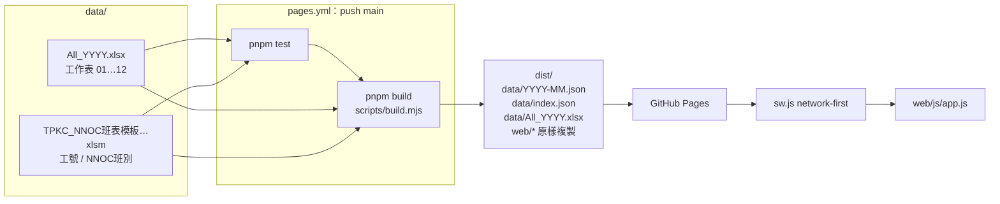

# 架構

純靜態站：建置時把 Excel 轉成 JSON，前端是不經打包的原生 ES modules，部署到 GitHub Pages。



## 1. Build

| 檔案 | 職責 |
|---|---|
| `.github/workflows/pages.yml` | push `main` → `pnpm install` → `pnpm test` → `pnpm build` → 上傳 `dist/` 部署。任一步失敗，網站維持上一版。 |
| `scripts/build.mjs` | 讀 DB 對照表 → 逐一讀 `data/All_YYYY.xlsx` 的 `01`…`12` 工作表 → 每月寫一個 `dist/data/YYYY-MM.json`，並把每個 xlsx 複製到 `dist/data/` 供下載 → 寫 `index.json` → 複製 `web/`。 |
| `scripts/lib/excel.mjs` | `readWorkbook`（SheetJS，`cellStyles: true` 讓儲存格帶底色）、`sheetLeaders`（橘色 `FFC000` 底 = leader）、`readLookups`（工號表、NNOC班別時間）、`findDayHeader`、`parseMonthSheet`。 |
| `scripts/lib/shift-rules.mjs` | 班別代碼的靜態規則表。 |

### 共用的資料物件

建置端的 `parseMonthSheet` 輸出、`YYYY-MM.json`、前端 `store.data`（已載入月份合併後）是**同一個形狀**，所以 `schedule.js` 的函式可以直接套在單月解析結果上（`excel.test.mjs` 就是這樣測），也能套在前端合併後的資料：

```js
{
  dates: ['YYYY-MM-01', …],                     // 整月每一天（只在單月檔案）
  writtenDays: { 'YYYY-MM': n },                // 日期列寫到第幾天；合併後每個已載入月份一筆
  shifts: { [code]: { type, label, group, color, rest, start, end, fullStart?, fullEnd? } },
  employees: [{ empId, name }],                 // 前端合併成 Map
  records: [{ empId, date, code, leader? }],
  warnings: [string]
}
// dist/data/index.json
{ months: ['2025-01', …], generatedAt: ISO }   // generatedAt 也用來判斷「有新版」
```

某人某天的狀態一律由 `schedule.dayState(data, empId, date)` 判斷：

| `DAY_STATE` | 條件 | 畫面 |
|---|---|---|
| `work` / `rest` | 有班別代碼 | 班別、時間、顏色 |
| `unwritten` | 月份已載入，但日期列還沒寫到這天（對所有人都一樣） | 虛線框、「尚未排班」 |
| `none` | 日期列已寫到，但此人沒有代碼（該月沒有他的列，如新進、離職；或這格空白） | 「—」、「此日期沒有排班資料」 |
| `unpublished` | 月份沒發布（或還沒載入） | 「—」、「無資料」 |

`schedule.isWritten(data, date)` 判斷「整天」是否已排（日期列有沒有寫到），用在當日班表與狀態列。

### 日期列的判斷

- 從 `1` 開始的連續數字。連續 28 天以上就視為完整月份（舊規則）。
- 不到 28 天時，`Total` 欄標題必須在第 1 天往左兩欄，位置在同一列或上一列。現有 25 張表都是「上一列」。
- 超過該月天數仍然報錯。不足時不報錯，只在 build log 印警告，所以日期列打錯字的完整月份會變成「只排到一半」，不會讓部署失敗。

## 2. 前端

沒有框架、沒有打包（`vite` 只用在 `pnpm preview`）。`index.html` 是靜態骨架，JS 只填內容與切換 `hidden`。模組載入順序由 import 決定：`context.js` 先跑完（含 `await createStore`），各分頁模組才綁定事件。

| 檔案 | 職責 |
|---|---|
| `js/theme.js` | 在 `<head>` 同步執行，三態主題 |
| `js/context.js` | 啟動：舊 localStorage key 搬移、註冊 SW、載入 store（失敗顯示錯誤並中止）；匯出 `store`、`data`、`months`、`employees`、`router`、共用 `state`、`ensure`、`hasDate` |
| `js/personal.js` | 個人班表：月曆／週列表、日期明細、統計、同班同事、年月選擇器、ICS、格子高度量測。私有狀態：`month`、`selectedDate`、`view` |
| `js/on-duty.js` | 當日班表：名單、篩選列、日期切換、「現」。私有狀態：`rosterFilter`、`followToday`、render 序號 |
| `js/employee.js` | 工號表單、詢問視窗、自動完成、`#/personal` 路由邏輯 |
| `js/app.js` | 外框：Excel 下載連結、來源提醒、狀態列、分頁切換、路由表、定時刷新與回到前景檢查新版 |
| `js/dom.js` | `element`、`textNode`、`notice`、`dateLabel`、`onSwipe` |
| `js/schedule.js` | 業務邏輯（純函式，Node 測試也 import）：`dayState`、`isWritten`、當班判斷、分類統計、分組、ICS |
| `js/store.js` | 按需載入月份並合併成 `data` |
| `js/router.js` | hash router |
| `sw.js` | network-first + 離線快取；`SHELL` 清單與 `CACHE` 版本號手動維護 |

跨模組共用的狀態只剩 `state.employee`（個人班表顯示的人，當日班表用來標「我」）與 `state.activeTab`。

渲染仍是「狀態改了就整區 `replaceChildren()` 重畫」：

```
router '/personal/:empId?' → employee.routePersonal → personal.showEmployee → showPersonal (await ensure)
                                                         └ renderPersonal → renderCalendar | renderWeek → renderSelectedDay + renderInsights
router '/on-duty' → onDuty.showOnDuty → renderOnDuty (await ensure) → renderRoster ×2
定時 30s / visibilitychange → refreshLive、checkPublished（有新版就 reload，否則載入今天月份並更新狀態列）
```

## 3. 還沒處理、之後值得做的

1. **`showPersonal` 沒有防過期 render**（當日班表有 `onDutyRun`）。render 時讀的是共用的 `month`，不會畫錯月份；但快速連續滑動時，可能先用還沒載入的月份畫一次，短暫出現整月「—」。
2. **`data.records` 是扁平陣列**，`dayState` 每次都線性搜尋。一個月曆約 31 × 4,000 次比較，目前沒問題；要做跨年統計時再加索引。
3. **SW 的 `SHELL` 與 `CACHE` 手動維護**。新增 `web/` 檔案時要記得改，之後若改用 Vite 打包可以自動產生。
4. **規則分在兩處**：班別規則在 `shift-rules.mjs`，分類 `shiftCategory` 在 `schedule.js`。
5. **`excel.test.mjs` 會跑 `data/` 裡的真實資料**，壞資料會讓 test 先失敗，錯誤訊息比 build 少。
6. **統計（早／中／晚／N／休）、連續上班、下個休假日仍直接掃 `records`**，沒有走 `dayState`；也不計「未排」天數，月份排到一半時加總會少於該月天數。
7. **前端沒有自動化 UI 測試**。重構時曾在暫存目錄用 jsdom 載入 `dist/` 跑過一遍，但沒有放進 repo。
