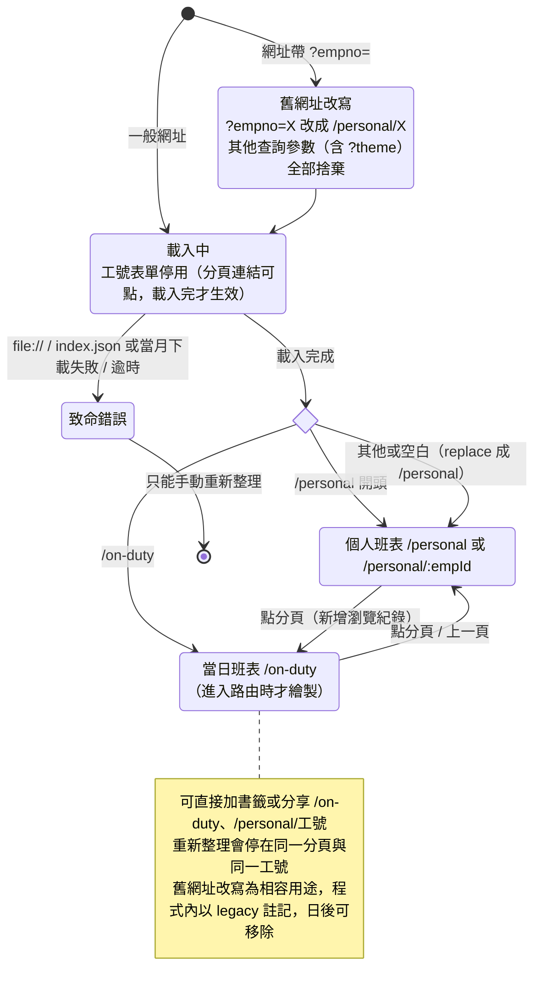
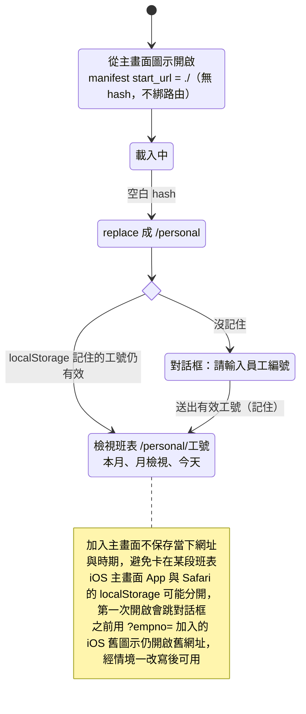
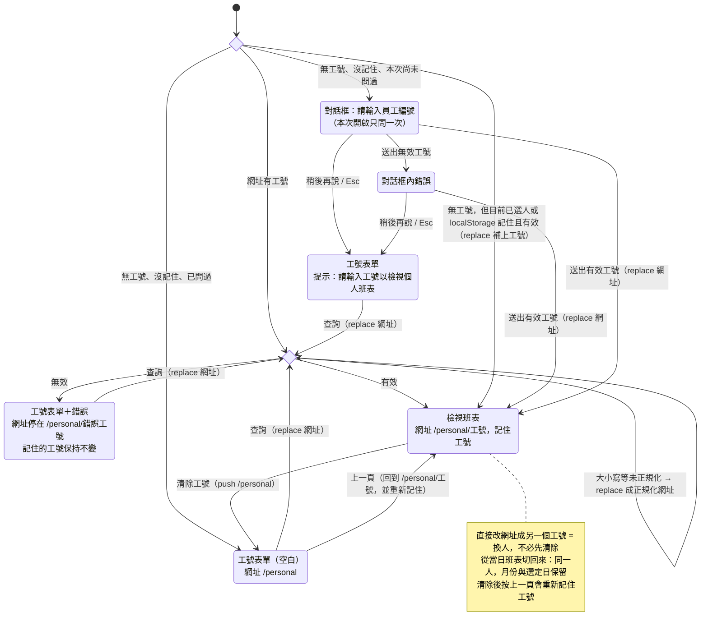
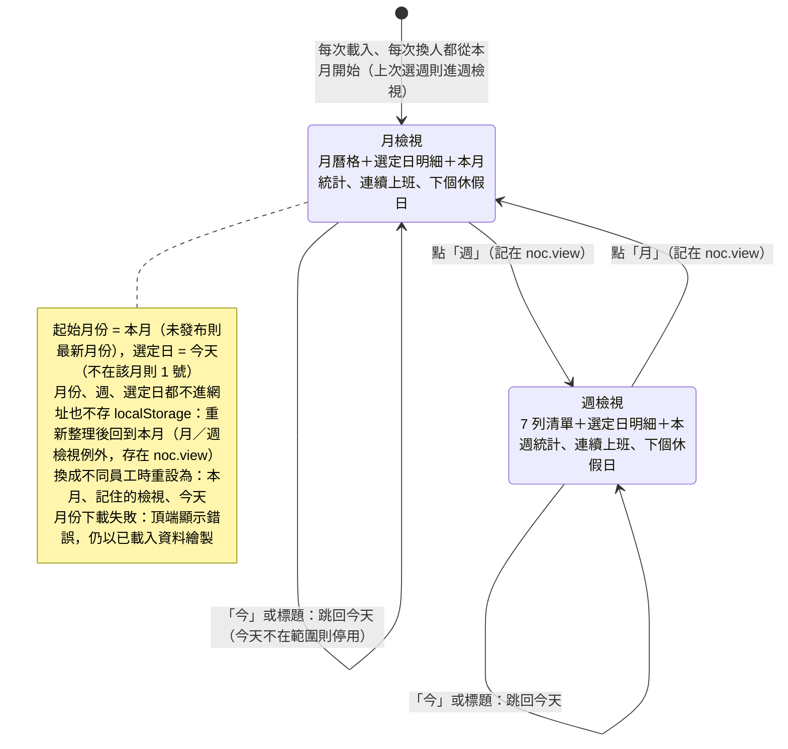
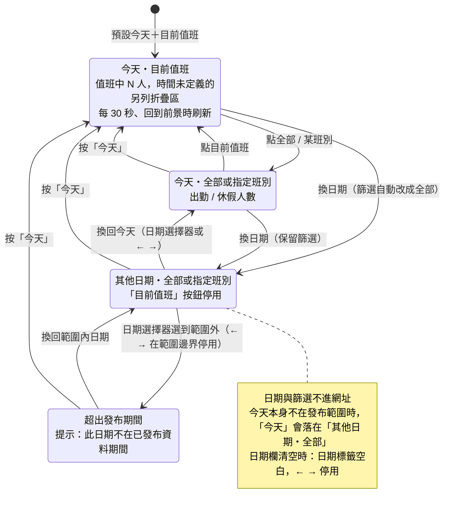
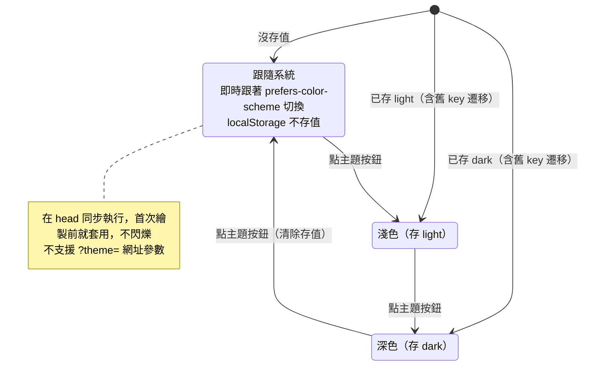
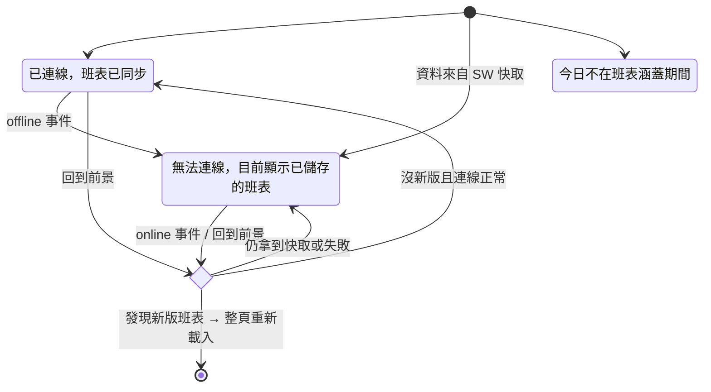

# UX 狀態圖

依程式碼實際行為整理（`web/js/app.js`、`router.js`、`store.js`、`theme.js`、`web/index.html`、`web/manifest.webmanifest`）。

路由：`#/personal`、`#/personal/:empId`、`#/on-duty`；月份、週、選定日一律不進網址。

---

## 情境一：開啟網站（瀏覽器網址、書籤、分享連結）

## 情境二：從主畫面圖示開啟（PWA）

## 情境三：個人班表的工號（由路由驅動）

## 情境四：瀏覽個人班表（月 / 週檢視）

## 情境五：查看當日班表 /on-duty

## 情境六：切換主題（三態圓形按鈕，圖示顯示目前選擇）

## 情境七：連線與資料更新（標題旁狀態列，獨立於其他狀態）

